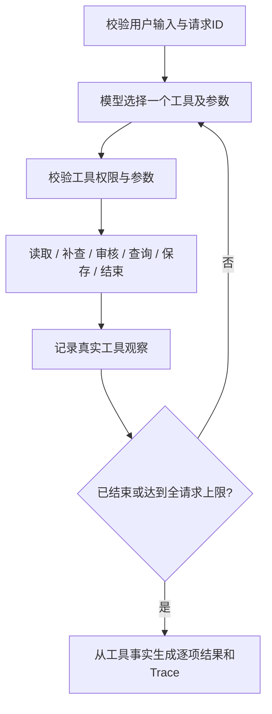

# 02 方案与动态决策

## 调用流程

入口 `cli.py` 解析文件及故障注入；`domain.py` 校验用户输入并运行规则；`models.py` 接入模型；`engine.py` 负责有界循环和工具分发；`store.py` 用 SQLite 执行事务。

每份素材作为明确绑定的工具上下文，模型不能通过传入别的素材 ID 越界操作。批量项目共享数据库和全请求调用预算；某项耗尽预算后，其余项目仍返回逐项 `incomplete_step_limit`，不会被静默忽略。

## 两种模式的真实职责

`--model live`：每轮通过 Chat Completions 的 `tools` 发出六个业务动作的 JSON Schema，读取模型实际选择的工具名称、参数和简短依据，执行工具后将原始 assistant tool call 和实际 tool observation 回传。支持 DeepSeek 思考模式要求的原调用 ID 和 `reasoning_content` 内存回传；内部思考内容不会写入 Trace。没有从条件分支生成“模型决策日志”。

服务商使用 `tool_choice=auto`，避免 DeepSeek 思考模式拒绝 `required` 的兼容问题。提示要求每轮一个动作；返回零个/多个调用、非法 JSON 或超限响应体时明确停止并返回模型错误。没有隐式重试或回退 Mock。HTTP 请求超时为 45 秒，最大响应体 1 MiB，输出预算 4096 tokens。全请求步数有界，但不是严格的墙钟时间上限。

`--model mock`：确定性的观察驱动策略，检查上一轮真实工具结果再返回动作。补查为空会结束，补查成功会重新审核；时段变化会选不同时间；保存失败最多再试一次。这证明工具契约和状态闭环可以运行，**不证明真实模型 ReAct 决策合格**。结构化测试结果和文档始终保留该边界。

接口依据于 2026-11-04 核对的 [OpenAI Function calling](https://developers.openai.com/api/docs/guides/function-calling)、[DeepSeek Tool Calls](https://api-docs.deepseek.com/guides/tool_calls/) 和 [DeepSeek Chat Completions](https://api-docs.deepseek.com/api/create-chat-completion/)。未启用 DeepSeek beta strict；应用始终自行校验工具参数。未假定“DeepSeek 4.1”就是某个 API 模型 ID。

## 工具契约

| 动作 | 参数 | 返回及限制 |
|---|---|---|
| read_material | 空 | 元数据、已有草稿，未知素材返回缺资料 |
| supplement_metadata | 空 | 合成资料中可补字段；只填空缺、不覆盖已有版权/隐私风险；单素材最多补查一次 |
| check_rules | 空 | approved / needs_info / blocked、缺失字段、全部风险 |
| query_slots | 空 | 当日可用时段、占用原因；原时间可用性 |
| save_draft | slot | 必须已审核通过且观察过可用时段；提交前再查冲突；返回回执或失败 |
| finish | 空 | 必须有保存、风险、缺资料、无时段或明确失败等证据 |

各模型调用还附带 `rationale` 字符串，用于记录短的可见行动依据；该字段不是工具权限，也不要求内部思维过程。所有元数据按不可信数据处理。没有 publish、approve、修改用户要求或执行任意代码的工具。

## 确认与幂等

- 选中原时间：已满足原请求，可形成已确认草稿。
- `hard_time=false`：用户允许当日候选时段内调整，可形成已确认草稿。
- 硬性要求下选中替代时间：只有 `approved_slots[material_id]` 精确等于该时段才确认，否则 `pending_user`。待确认不等于原要求已改变。
- 请求 ID 与规范化完整请求摘要绑定；同 ID 改输入会拒绝，避免缓存式误覆盖。
- 数据库唯一约束 `(material_id, channel)` 保证一个活动草稿，即使换请求 ID 或并发重复也不会新增第二份。
- 用户精确确认更新原草稿，草稿 ID 保持不变；旧的未确认请求重放不会降低已确认状态。
- 已有草稿的原要求不同则拒绝覆盖；变更已有草稿的时段也须精确批准。本版本没有通用草稿修改/取消接口。

`BEGIN IMMEDIATE` 将冲突检查与写入放在一个事务中，包含其它待确认草稿的预约区间。两个连接同时保存不同素材同一时间时，只允许一个成功。相同业务并发保存时，一次创建、一次重复回执。保存故障在写入后、提交前注入，测试实际回滚；成功回执只在 commit 后生成。

## 工程选择

选择标准库而非框架，以便评审不安装依赖即可看到决策循环、协议边界和事务逻辑。框架没有承担任何职责，也无框架版本声明。运行基线 Python 3.11，实测 3.11.4。未加入 UI、多 Agent、部署等非核心模块。

数据集有内容摘要绑定；换规则、素材或已有排期必须选新数据库，避免未说明的资料更新破坏旧草稿含义。真实业务应改为版本化素材、排期同步与再审核，本次明确保留此限制。
